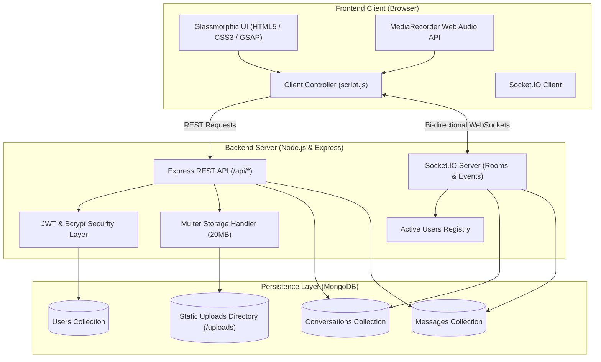
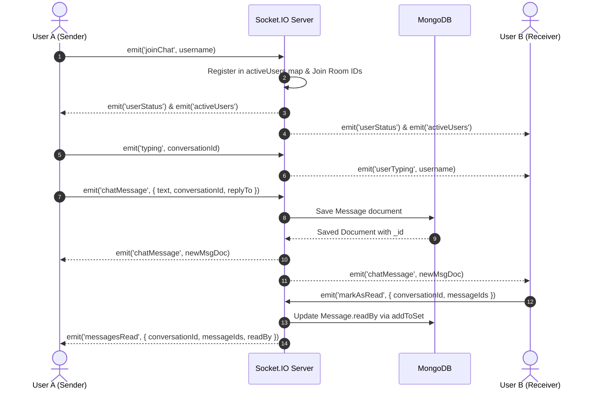
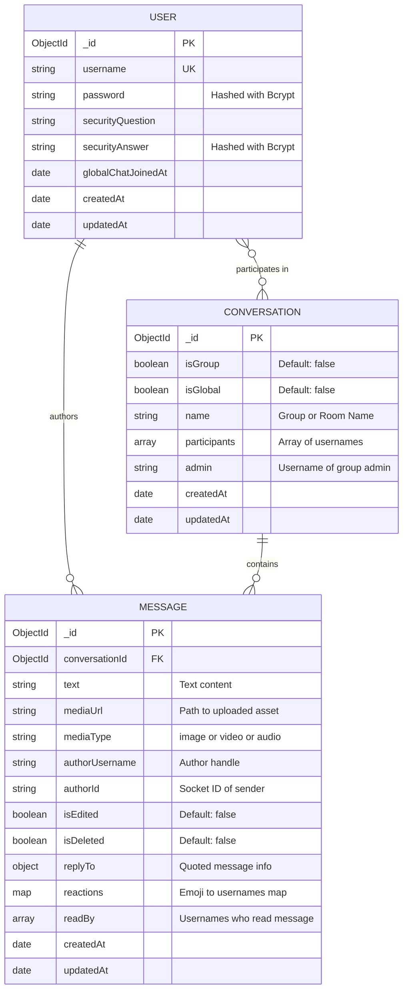

<div align="center">

# 🚀 Convofy

### *Next-Generation Real-Time Messaging & Collaboration Platform*

[](https://nodejs.org/)
[](https://expressjs.com/)
[](https://socket.io/)
[](https://www.mongodb.com/)
[](https://gsap.com/)
[](LICENSE)

<p align="center">
  <b>Convofy</b> is a full-stack, enterprise-grade real-time web chat application engineered with <b>Node.js</b>, <b>Express</b>, <b>Socket.IO</b>, and <b>MongoDB</b>. Featuring a glassmorphism design system powered by <b>GSAP</b>, Convofy delivers sub-millisecond bidirectional communication, multimodal file & voice note sharing, role-based group management, granular message interaction (reactions, edits, replies, read receipts), and dual-mode authentication.
</p>

[Explore Key Features](#-key-features) • [System Architecture](#-system-architecture) • [API & Socket Reference](#-api--socketio-specifications) • [Evaluator Quickstart](#-evaluators-quickstart--installation) • [Live Evaluation Walkthrough](#-evaluator-testing-scenarios)

---

</div>

## 📑 Table of Contents

- [Project Overview](#-project-overview)
- [Key Features](#-key-features)
  - [Real-Time Messaging Engine](#1-real-time-messaging-engine)
  - [Multi-Paradigm Conversations](#2-multi-paradigm-conversations)
  - [Group Administration & Governance](#3-group-administration--governance)
  - [Multimodal Media & Built-in Voice Notes](#4-multimodal-media--built-in-voice-notes)
  - [Rich Message Ergonomics](#5-rich-message-ergonomics)
  - [Dual Authentication & Guest Sandbox](#6-dual-authentication--guest-sandbox)
  - [Modern Glassmorphism UI & Theme Engine](#7-modern-glassmorphism-ui--theme-engine)
- [System Architecture](#-system-architecture)
  - [High-Level Architecture](#high-level-architecture)
  - [WebSocket Event Lifecycle](#websocket-event-lifecycle)
  - [Database Entity Relationship Diagram (ERD)](#database-entity-relationship-diagram-erd)
- [Tech Stack & Engineering Justifications](#-tech-stack--engineering-justifications)
- [Database Schemas & Data Models](#-database-schemas--data-models)
- [API & Socket.IO Specifications](#-api--socketio-specifications)
  - [REST API Endpoints](#rest-api-endpoints)
  - [Socket.IO Events](#socketio-events)
- [Security & Performance Architecture](#-security--performance-architecture)
- [Project Directory Structure](#-project-directory-structure)
- [Evaluator's Quickstart & Installation](#-evaluators-quickstart--installation)
- [Evaluator Testing Scenarios](#-evaluator-testing-scenarios)
- [Future Roadmap](#-future-roadmap)
- [Author & Acknowledgements](#-author--acknowledgements)

---

## 🌟 Project Overview

Modern web communication tools demand high responsiveness, multi-device reliability, zero-latency interactions, and elegant user interfaces. **Convofy** addresses these demands by combining an asynchronous, event-driven Node.js & WebSocket backend with a reactive vanilla JavaScript frontend, wrapped in an eye-catching glassmorphism aesthetic.

### Why Convofy Stands Out for Project Evaluation
1. **Full-Stack Independence**: Built with zero heavy frontend framework bloat—vanilla JavaScript (ES6+), semantic HTML5, and CSS custom properties demonstrate foundational engineering mastery.
2. **Deep Real-Time Integration**: Uses Socket.IO rooms, broadcast flags, and bidirectional socket events to power multi-room routing, live presence, typing indicators, and double-check read receipts.
3. **Enterprise Security Practices**: Bcrypt password hashing with unique salts, stateless JWT authorization, security-question password reset pipelines, and strict client/server XSS escaping.
4. **Accessible Guest Mode**: Evaluators and first-time reviewers can inspect the global room instantly with a single click without having to register an account first.

---

## ✨ Key Features

### 1. Real-Time Messaging Engine
- **Sub-Millisecond Event Dispatch**: Direct WebSocket communication using Socket.IO transports (`websocket`, falling back to `polling`).
- **Room-Based Channel Segregation**: Dynamic socket joining (`socket.join(conversationId)`) ensures messages, typing alerts, and receipts are routed strictly to authorized participants.
- **Live User Presence**: Real-time counter and active user roster tracking connections and disconnections in real time.
- **Dynamic Typing Indicators**: Debounced multi-user typing status ("*Alice is typing...*", "*Alice and Bob are typing...*").

### 2. Multi-Paradigm Conversations
- **Global Public Lobby (`Convofy Global`)**: Auto-instantiated shared channel available to all registered users and guests. For registered members, a chronological entry-point filter ensures new users only receive messages sent after they joined.
- **Direct 1-on-1 Chats**: Private encrypted-in-transit peer-to-peer style communication between any two registered users.
- **Custom Multi-Member Groups**: Users can spin up custom groups with selected contacts and distinct room IDs.

### 3. Group Administration & Governance
- **Role-Based Admin Control**: Group creator is designated as the administrator with exclusive governance capabilities.
- **Real-Time Group Management**:
  - **Dynamic Renaming**: Update the group title across all connected client tabs simultaneously.
  - **Add Members**: Interactive searchable dropdown to invite registered members who are not yet in the group.
  - **Kick/Remove Members**: Expel participants with live socket event propagation and system notification messages.

### 4. Multimodal Media & Built-in Voice Notes
- **Direct Image & Video Sharing**: Integrated file upload via Multer disk storage (up to 20MB limit) with automated MIME type inspection (`image/*`, `video/*`).
- **In-Browser Audio Recording (Voice Notes)**: Utilizes the browser's native `MediaRecorder` API and `navigator.mediaDevices.getUserMedia` to record audio directly from the microphone, compress it into `audio/webm`, upload it asynchronously, and stream it back into chat with an audio player.

### 5. Rich Message Ergonomics
- **In-Place Message Editing**: Authors can update previously sent text messages; updates propagate instantaneously with an `(Edited)` indicator.
- **Soft Message Deletion**: Safe deletion preserving chat history continuity with a clear visual placeholder (`🚫 This message was deleted`).
- **Interactive Emoji Reactions**: Users can react to any message with emojis (👍, ❤️, 😂). Reactions toggle dynamically with live count aggregation and hoverable participant tooltips.
- **Reply & Quote Chaining**: Contextual quote box linking new messages directly to referenced historical messages.
- **Read Receipts**: WhatsApp-style delivery indicators—single check (`✓`) for sent messages transitioning dynamically into double blue checks (`✓✓`) once read by other room participants.
- **Integrated Emoji Picker**: Embedded [`emoji-picker-element`](https://github.com/nolanlawson/emoji-picker-element) for rapid emoji insertion with cursor position retention.

### 6. Dual Authentication & Guest Sandbox
- **Secure JWT Flow**: Stateless 7-day token issuance upon valid password verification via `bcryptjs`.
- **2-Step Password Recovery**: Security question challenge-and-response protocol with case-insensitive hashed answer matching.
- **Cross-Tab Session Bus**: Synchronizes `sessionStorage` tokens across concurrent browser tabs using HTML5 `storage` event triggers without leaving persistent credentials on disk.
- **Sandboxed Guest Mode**: Instant access with a generated `Guest_XXXX` pseudonym; allows read/write participation in the Global Room while strictly sandboxing administrative actions, group creation, private chats, and media uploads.

### 7. Modern Glassmorphism UI & Theme Engine
- **Glassmorphic Aesthetic**: Multi-layered panels featuring `backdrop-filter: blur(24px)`, refined border lighting, and subtle box shadows.
- **Dynamic GSAP Animations**: Smooth card entrance transitions, reactive button scaling, and ambient floating background orbs.
- **Dark & Light Mode Switcher**: Complete CSS custom property theming persisted in browser `localStorage`.
- **Responsive Layout**: Fluid flex and grid architectures optimized for desktop, tablet, and mobile viewport widths.

---

## 🏗️ System Architecture

### High-Level Architecture



---

### WebSocket Event Lifecycle



---

### Database Entity Relationship Diagram (ERD)



---

## 🛠️ Tech Stack & Engineering Justifications

| Tier | Technology | Purpose & Rationale |
| :--- | :--- | :--- |
| **Runtime** | [Node.js](https://nodejs.org/) (v18+) | Asynchronous, non-blocking I/O event loop perfectly tuned for concurrent real-time socket connections. |
| **Backend Framework** | [Express.js](https://expressjs.com/) (v4.19) | Minimalist, robust HTTP web server framework for routing REST endpoints and serving static assets. |
| **Real-Time Protocol** | [Socket.IO](https://socket.io/) (v4.7) | Reliable low-latency WebSocket communication with automatic fallback to HTTP long-polling, heartbeat monitoring, and native room segregation. |
| **Database & ODM** | [MongoDB](https://www.mongodb.com/) & [Mongoose](https://mongoosejs.com/) (v9.5) | Document-oriented NoSQL storage offering schema flexibility, native subdocuments, and high write throughput for messages and reactions. |
| **Authentication** | [JSON Web Tokens](https://jwt.io/) & [bcryptjs](https://github.com/dcodeIO/bcrypt.js) | Stateless, cryptographic access control (`HS256`) combined with slow-hash password and security-answer encryption (salt rounds: 10). |
| **Media Handling** | [Multer](https://github.com/expressjs/multer) (v2.1) | Streaming multipart/form-data middleware handling direct-to-disk storage with filename hashing and size validation. |
| **Frontend Framework** | **Vanilla JavaScript (ES6+)** | Zero-dependency, framework-free client logic ensuring high rendering speed, low bundle overhead, and deep DOM control. |
| **Styling & Design** | **CSS3 Glassmorphism** | Modern aesthetic utilizing `backdrop-filter`, radial color gradients, CSS custom variables, and responsive flex/grid wrappers. |
| **UI Motion & FX** | [GSAP 3.12](https://gsap.com/) | High-performance tweening engine driving floating background orbs and smooth screen-switching transitions. |
| **Web APIs** | **MediaRecorder API** | Native browser audio stream capture enabling real-time voice notes without third-party plugins. |
| **Components** | [`emoji-picker-element`](https://github.com/nolanlawson/emoji-picker-element) | Accessible, lightweight custom web component for searchable emoji selection. |

---

## 🗄️ Database Schemas & Data Models

### 1. `User` Model (`models/User.js`)
Stores authenticated user credentials, recovery information, and timestamp filters.
```javascript
{
  username: { type: String, required: true, unique: true, trim: true, minlength: 3 },
  password: { type: String, required: true, minlength: 6 }, // Hashed
  securityQuestion: { type: String, required: true, default: 'What is your pet name?' },
  securityAnswer: { type: String, required: true }, // Case-insensitive hashed
  globalChatJoinedAt: { type: Date, default: Date.now } // Filters history for global room
}
```

### 2. `Conversation` Model (`models/Conversation.js`)
Represents chat rooms (Global, 1-on-1 Direct Messages, or Custom Groups).
```javascript
{
  isGroup: { type: Boolean, default: false },
  isGlobal: { type: Boolean, default: false },
  name: { type: String, default: '' },
  participants: { type: [String], default: [] }, // Array of usernames
  admin: { type: String, default: null }         // Username of group creator
}
```

### 3. `Message` Model (`models/Message.js`)
Handles rich content, media references, reactions, and conversational threading.
```javascript
{
  text: { type: String, default: '' },
  mediaUrl: { type: String, default: null },
  mediaType: { type: String, default: null }, // 'image' | 'video' | 'audio'
  authorUsername: { type: String, required: true },
  authorId: { type: String, required: true }, // Socket ID
  isEdited: { type: Boolean, default: false },
  isDeleted: { type: Boolean, default: false },
  replyTo: {
    messageId: { type: mongoose.Schema.Types.ObjectId, ref: 'Message' },
    text: String,
    authorUsername: String
  },
  reactions: { type: Map, of: [String], default: {} }, // Emoji -> [Usernames]
  conversationId: { type: mongoose.Schema.Types.ObjectId, ref: 'Conversation', required: true },
  readBy: { type: [String], default: [] }
}
```

---

## 📡 API & Socket.IO Specifications

### REST API Endpoints

| Method | Endpoint | Access | Description | Request Body / Params | Expected Response |
| :--- | :--- | :--- | :--- | :--- | :--- |
| `POST` | `/api/register` | Public | Register new user account | `{ username, password, securityQuestion, securityAnswer }` | `201 Created` with JWT token & username |
| `POST` | `/api/login` | Public | Authenticate existing user | `{ username, password }` | `200 OK` with JWT token & username |
| `GET` | `/api/verify` | Header | Validate current JWT token | Header: `Authorization: Bearer <token>` | `200 OK` with `{ username }` |
| `POST` | `/api/forgot-password-question` | Public | Retrieve security question | `{ username }` | `200 OK` with `{ question }` |
| `POST` | `/api/forgot-password-reset` | Public | Verify answer & set new password | `{ username, securityAnswer, newPassword }` | `200 OK` with success message |
| `GET` | `/api/users` | Public | Fetch list of registered usernames | None | `200 OK` with array of users |
| `GET` | `/api/conversations/:username` | Public | Fetch user conversations & global room | Route Param: `:username` | `200 OK` with conversations array |
| `GET` | `/api/messages/:conversationId` | Public | Fetch chronological chat messages | Param: `:conversationId`, Query: `?username=` | `200 OK` with messages array |
| `POST` | `/api/upload` | Member | Upload image, video, or voice audio | Multipart `FormData` with field `media` | `200 OK` with `{ mediaUrl, mediaType }` |

---

### Socket.IO Events

#### Client to Server (`socket.emit`)
| Event Name | Payload Structure | Purpose |
| :--- | :--- | :--- |
| `joinChat` | `username` *(string)* | Announces presence, binds socket to user, joins rooms |
| `chatMessage` | `{ text, mediaUrl, mediaType, conversationId, replyTo }` | Broadcasts new message to the room |
| `typing` | `conversationId` *(string)* | Signals active typing to room peers |
| `stopTyping` | `conversationId` *(string)* | Signals cessation of typing to room peers |
| `markAsRead` | `{ conversationId, messageIds: [] }` | Updates read receipt status for designated messages |
| `editMessage` | `{ messageId, newText }` | Modifies previously sent message text |
| `deleteMessage`| `messageId` *(string)* | Soft-deletes a message by ID |
| `messageReaction`| `{ messageId, reaction: "👍" }` | Toggles emoji reaction on a message |
| `startPrivateChat`| `{ targetUsername }` | Queries or instantiates a 1-on-1 private conversation |
| `createGroup` | `{ name, participants: [] }` | Creates a new group conversation with designated members |
| `adminAction` | `{ action: "add"\|"kick"\|"rename", conversationId, targetUser, newName }` | Executes admin governance operations on a group |

#### Server to Client (`socket.on`)
| Event Name | Payload Structure | Purpose |
| :--- | :--- | :--- |
| `activeUsers` | `{ count: number, users: string[] }` | Broadcasts global online user count and usernames |
| `userStatus` | `{ type: "join"\|"leave", message, timestamp }` | Broadcasts connection and disconnection activity |
| `chatMessage` | `MessageDocument` | Delivers newly published message to all room members |
| `messagesRead` | `{ conversationId, messageIds, readBy }` | Updates blue double checkmarks (`✓✓`) |
| `messageEdited`| `MessageDocument` | Re-renders edited message in real time |
| `messageDeleted`| `MessageDocument` | Updates deleted message placeholder in real time |
| `messageReactionUpdated` | `{ messageId, reactions: { emoji: [users] } }` | Synchronizes emoji reaction counts |
| `userTyping` | `{ username, conversationId }` | Displays dynamic typing bubble |
| `userStoppedTyping` | `{ username, conversationId }` | Clears dynamic typing bubble |
| `conversationCreated` | `ConversationDocument` | Appends new conversation to sidebar in real time |
| `guestRestricted`| `{ message: string }` | Sends security warning for unpermitted guest actions |

---

## 🔒 Security & Performance Architecture

1. **Password Encryption & Salt Generation**:
   - Implemented via `bcryptjs` using 10 salt rounds.
   - Security recovery answers are trimmed, converted to lowercase, and hashed with distinct salts to eliminate case-sensitivity issues while preventing plaintext disclosure.
2. **Stateless JWT Authorization**:
   - Access tokens are cryptographically signed using a server-side secret (`JWT_SECRET`) and issued with a 7-day expiration lifespan.
3. **Defense-in-Depth Guest Restrictions**:
   - Frontend: Context menus, attachment buttons, and group creation buttons are hidden in Guest Mode.
   - Backend: Explicit server validation blocks guest sockets (`Guest_*`) from executing admin actions, starting private chats, creating groups, or uploading files via `x-guest-mode` header inspection.
4. **Cross-Site Scripting (XSS) Sanitization**:
   - All user-supplied strings are sanitized through a custom `escapeHTML()` entity encoder before being inserted into DOM nodes:
     ```javascript
     function escapeHTML(str) {
         if (!str) return '';
         return str.replace(/[&<>'"]/g, tag => ({
             '&': '&amp;', '<': '&lt;', '>': '&gt;', "'": '&#39;', '"': '&quot;'
         }[tag] || tag));
     }
     ```
5. **Secure Cross-Tab Storage Bus**:
   - Tokens reside in `sessionStorage` (cleared automatically when browser/tab is closed).
   - When a secondary tab opens, it broadcasts a temporary `localStorage` ping (`getSessionStorage`), prompting existing tabs to transfer the session token without persisting sensitive authentication tokens permanently in local disk storage.
6. **File Upload Hardening**:
   - Configured with disk storage isolation (`public/uploads`), strict 20MB payload caps, and unique timestamp random suffixes (`Date.now() + '-' + Math.round(Math.random() * 1E9)`) preventing file-overwrite vulnerabilities.

---

## 📂 Project Directory Structure

```text
Convofy/
├── models/                           # Mongoose Data Schemas
│   ├── Conversation.js               # Conversation room schema (Global, Group, Private)
│   ├── Message.js                    # Message schema (Text, Media, Reactions, Replies, Receipts)
│   └── User.js                       # User authentication & security question schema
├── public/                           # Client-Side Application Assets
│   ├── uploads/                      # Uploaded images, videos, and voice recordings
│   ├── index.html                    # Single-Page Application (SPA) structural layout
│   ├── style.css                     # Glassmorphic CSS styling, design tokens & theme classes
│   └── script.js                     # Core frontend controller (Socket.IO client, Web Audio, GSAP)
├── .env                              # Environment variable definitions (Local - gitignored)
├── .env.example                      # Production/Evaluation environment template
├── .gitignore                        # Git exclusion rules (node_modules, .env, uploads)
├── login-stitch.html                 # Alternative enterprise Tailwind UI showcase
├── package.json                      # NPM dependencies, metadata & scripts
├── package-lock.json                 # Dependency lockfile
├── push.bat                          # Convenience deployment automation script
├── README.md                         # Project documentation and evaluation guide
└── server.js                         # Application entrypoint, Express app & Socket.IO server
```

---

## 🚀 Evaluator's Quickstart & Installation

Follow these steps to set up and run the Convofy application locally for evaluation.

### Prerequisites
- [Node.js](https://nodejs.org/) (Version 18.x or higher recommended)
- [npm](https://www.npmjs.com/) (Installed automatically with Node.js)
- [MongoDB](https://www.mongodb.com/) (Local MongoDB instance or a free MongoDB Atlas connection string)

---

### Step 1: Clone Repository
```bash
git clone https://github.com/akshaykumar90537/Convofy-Chat-Application.git
cd Convofy-Chat-Application
```

### Step 2: Install Dependencies
```bash
npm install
```

### Step 3: Configure Environment Variables
Create a `.env` file in the project root (or copy `.env.example`):
```bash
cp .env.example .env
```
Populate `.env` with your parameters:
```env
PORT=3000
MONGODB_URI=mongodb://127.0.0.1:27017/convofy
JWT_SECRET=your_super_secret_jwt_key_here
```
> **Note**: Both `MONGODB_URI` and `MONGO_URI` are supported by `server.js`. If you have a MongoDB Atlas connection string, paste it directly into `MONGODB_URI`.

### Step 4: Launch the Server
```bash
npm start
```
*Expected Console Output:*
```text
Connected to MongoDB
Server is running on http://localhost:3000
```

### Step 5: Access the Web App
Open your web browser and navigate to:
```
http://localhost:3000
```

---

## 🧪 Evaluator Testing Scenarios

To thoroughly evaluate all project features, follow these step-by-step testing scenarios:

### Scenario 1: One-Click Guest Access Mode
1. Open `http://localhost:3000`.
2. Click the **"Join Global Chat as Guest"** button.
3. Notice you are immediately assigned a unique identifier (e.g., `Guest_4821`) and admitted into `Convofy Global`.
4. Send a text message to observe live global communication.
5. Verify that guest-restricted features (attachment icon, microphone icon, group creation) are disabled or guarded.

### Scenario 2: User Registration & Real-Time Multi-Client Chat
1. Open an **Incognito / Private Window** (or a second browser).
2. Click **"Register"**, fill in a username (min 3 chars), password (min 6 chars), select a security question, and provide an answer.
3. Submit registration; you will transition into the chat interface automatically.
4. In the first window, register a second user account (e.g., `Alice` and `Bob`).
5. Send messages between both windows:
   - Notice real-time instant delivery with zero page reload.
   - Observe the **Live Online Users count** updating dynamically.
   - Notice the **Typing Indicator** appear when typing in the opposing input field.

### Scenario 3: Voice Notes & Media Attachments
1. In the chat input footer, click the **Attachment (Paperclip)** icon and select an image or video file.
   - The file is uploaded through Multer, and the image/video renders inline.
2. Click the **Microphone** icon (allow browser microphone permissions).
   - Speak for 3–5 seconds and click the microphone icon again to stop.
   - The audio is packaged as a `.webm` voice note, uploaded, and rendered with an embedded audio player.

### Scenario 4: Message Interactions (Edit, Delete, React, Reply, Read Receipts)
1. **Emoji Reactions**: Hover over any message and click an emoji reaction (👍, ❤️, 😂). Notice the reaction count update on both clients in real time.
2. **Reply / Quoting**: Click the **Reply (↩️)** button on a message. The context banner appears. Type a response and send; notice the quoted author and message preview.
3. **Editing**: On a message you authored, click the **Edit (✏️)** button, update the text, and submit. The text updates in real time with an `(Edited)` badge.
4. **Soft Delete**: Click the **Delete (🗑️)** icon on your message and confirm. The message updates to `🚫 This message was deleted`.
5. **Read Receipts**: Notice that messages sent by your account show a single check (`✓`), which transitions to double blue checks (`✓✓`) as soon as the other participant views the chat.

### Scenario 5: Group Chats & Role-Based Admin Controls
1. In the sidebar, click the **"+"** button next to *Conversations*.
2. Enter a group name (e.g., *Dev Team*) and check one or more registered users. Click **"Create Group"**.
3. As the creator/admin, click the **Group Settings (⚙️)** icon in the header:
   - **Rename**: Change the name to *Core Dev Team* and click **Rename**—all participants receive the updated title instantly.
   - **Manage Members**: Click **Kick** next to a member—a system notification announces their removal, and they are removed from the room.
   - **Add Members**: Search for an existing registered member and click **+ Add** to invite them into the group.

### Scenario 6: Security Question Password Reset
1. Click the top-right options menu `⋮` and select **Logout**.
2. Click **"Forgot Password?"**.
3. Enter your registered username and click **Next**.
4. The system retrieves your exact security question.
5. Provide your answer (answers are case-insensitive) and set a new password.
6. Log in with your new password to verify successful password reset.

### Scenario 7: Theme Customization & Cross-Tab Sync
1. Open the top-right dropdown and click **"Toggle Theme"** to toggle between Dark Mode and Light Mode. Refresh the page to verify that the theme preference persists.
2. Open a new tab pointing to `http://localhost:3000`—notice you are automatically authenticated without needing to log in again, powered by the cross-tab session bus.

---

## 🔮 Future Roadmap

Convofy is continuously evolving. Planned future capabilities include:
- [ ] **End-to-End Encryption (E2EE)**: Implementation of the Signal Protocol for client-side cryptographic message encryption.
- [ ] **WebRTC Voice & Video Calling**: Direct peer-to-peer 1-on-1 and group audio/video conference streaming.
- [ ] **Push Notifications**: Web Push API and Service Worker integration for offline message delivery alerts.
- [ ] **Full-Text Message Search**: MongoDB text indexes with search highlights across personal and group message histories.
- [ ] **File Preview Modal**: Fullscreen lightbox viewer for photos, videos, and PDF document previews.

---

## 👨‍💻 Author & Acknowledgements

**Developed with ❤️ by Akshay Kumar**
- **GitHub**: [@akshaykumar90537](https://github.com/akshaykumar90537)
- **Repository**: [Convofy-Chat-Application](https://github.com/akshaykumar90537/Convofy-Chat-Application)

### Acknowledgements & Open-Source Libraries
- [Socket.IO](https://socket.io/) for reliable WebSocket abstractions.
- [GSAP (GreenSock)](https://gsap.com/) for animation primitives.
- [Emoji-Picker-Element](https://github.com/nolanlawson/emoji-picker-element) by Nolan Lawson.
- [Inter Font](https://fonts.google.com/specimen/Inter) by Rasmus Andersson.

---

<div align="center">
  <sub>Built for excellence. Evaluated on engineering rigor, clean code architecture, and high-performance real-time design.</sub>
</div>
